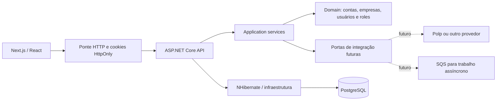

# Zelo

**Uma plataforma de gestão de despesas para empresas brasileiras.** O objetivo é reunir contas, empresas do grupo, pessoas autorizadas, cartões e transações em um espaço de trabalho com regras claras de acesso. O projeto está **em desenvolvimento**: a base de identidade, autorização e experiência de entrada já funciona; o módulo financeiro e as integrações bancárias ainda estão no roteiro.

> **Estado atual:** este repositório é uma demonstração técnica em evolução, não um produto financeiro pronto para uso em produção. As telas existentes cobrem cadastro, autenticação e o início do espaço de trabalho. Não há dados financeiros simulados no dashboard.

## O que já pode ser avaliado

- Cadastro de usuário com ou sem conta empresarial; confirmação de email e recuperação de senha.
- Login com JWT, refresh token persistido, encerramento de sessão e autenticação em duas etapas com TOTP e códigos de reserva.
- Uma pessoa pode pertencer a várias contas. Cada conta agrupa empresas; membros ativos da conta têm acesso às empresas conforme a role e suas permissões.
- Convites, roles configuráveis, alteração/suspensão de membros e acesso de administrador da plataforma. O backend aplica autorização e isolamento por tenant.
- CRUD inicial de empresas, auditoria na persistência, eventos de domínio em processo, migrações PostgreSQL e testes automatizados.
- Frontend de autenticação responsivo, ponte HTTP que guarda tokens em cookies `HttpOnly` e uma área autenticada que mostra as contas acessíveis.

A experiência de autenticação tem rotas para `/register`, `/confirm-email`, `/login`, `/forgot-password`, `/reset-password`, `/dashboard`, `/security` e `/recovery-codes`. Gestão de empresas, roles, membros e convites está disponível na API; as telas administrativas correspondentes ainda não foram construídas.

## Prévia da interface

Capturas reais da aplicação em desenvolvimento. O login e a verificação em duas etapas já fazem parte do fluxo de autenticação; o dashboard ainda é a base para os futuros módulos de despesas.

**Login**


**Verificação em duas etapas**


## Arquitetura



`User` é global. `Account` é o tenant e pode conter várias `Company`. `UserTenant` liga uma pessoa a uma conta e a uma `Role` daquela conta. O domínio não depende de ASP.NET, NHibernate ou de um fornecedor de dados financeiros. Controllers recebem requisições, application services coordenam casos de uso e repositórios implementam a persistência. O filtro de tenant no NHibernate é uma camada adicional de isolamento; a autorização continua verificando o vínculo e as permissões do usuário.

As especificações e decisões estão em [`docs/specs/`](docs/specs/). O código da API está em [`Api/`](Api/) e a interface em [`web/`](web/).

## Stack e motivos das escolhas

| Situação | Tecnologia | Papel e motivo |
| --- | --- | --- |
| Implementado | .NET 9 / ASP.NET Core | API tipada e composição explícita das camadas. |
| Implementado | NHibernate + PostgreSQL | Mapeamento do domínio e transações relacionais para usuários, contas, empresas, vínculos e permissões. |
| Implementado | AutoMapper | Conversão entre entidades e DTOs em um perfil central da aplicação. |
| Implementado | Next.js 16, React 19, TypeScript | Interface web e ponte entre navegador e API; tokens ficam em cookies `HttpOnly` no servidor web. |
| Implementado | React Router, React Hook Form, Zod | Rotas de aplicação e validação dos formulários. |
| Implementado | Vitest, xUnit e smoke tests | Verificação de regras, mapeamentos e fluxos reais com banco descartável. |
| Planejado | API da [Polp](https://polp.com.br/docs) como primeiro conector | Obter contas, cartões e transações mediante o fluxo de autorização adequado. O contrato do domínio ficará atrás de interfaces para permitir trocar o fornecedor. Nenhum conector está implementado hoje. |
| Candidato futuro | [Amazon SQS](https://docs.aws.amazon.com/sqs/) | Desacoplar sincronização de transações, webhooks e entrega de mensagens do tempo de resposta HTTP quando esses fluxos existirem. Exigirá consumidores idempotentes, tratamento de falhas e fila de mensagens não processadas; não é necessário para a base atual. |
| Candidato condicionado a volume e consultas | [Amazon DynamoDB](https://docs.aws.amazon.com/amazondynamodb/latest/developerguide/HowItWorks.CoreComponents.html) | Poderia armazenar uma projeção ou payload de alto volume com consultas bem definidas. **PostgreSQL permanece a fonte principal de dados**; DynamoDB só entra se medições e padrões de acesso justificarem a complexidade de um segundo banco. |

Eventos de domínio atuais são tratados dentro da aplicação, na mesma operação; isso não equivale a uma fila durável. Se SQS for adotado, a publicação confiável terá desenho próprio, por exemplo com outbox transacional e consumidores idempotentes. Cartões e transações ainda precisam de modelo, integrações, reconciliação e regras de retenção antes de serem apresentados como funcionalidades prontas.

## Executar localmente

Pré-requisitos: .NET SDK 9, Node.js 22.19+, npm, PostgreSQL local e ferramentas `psql`/`createdb`. O projeto não traz credenciais nem dados de demonstração.

```sh
cd web
cp .env.example .env.local
npm ci
npm run dev:api
```

Em outro terminal:

```sh
cd web
npm run dev
```

O script da API cria ou atualiza apenas o banco local `zelo_dev`, aplica as migrações pendentes e grava emails de desenvolvimento em `web/.local/mail/`. O segredo JWT local fica em `web/.local/api.json`; ambos estão fora do Git. Para testar uma caixa virtual, veja as instruções de [Mailpit no README do frontend](web/README.md).

## Verificar

```sh
dotnet test Api/Zelo/Zelo.sln
cd web
npm run validate
```

Os testes de integração reais podem ser executados com `python3 Api/scripts/auth_flow_smoke.py` e `npm run test:auth` (dentro de `web`). Eles usam bancos temporários e os removem ao terminar. Veja o [guia do frontend](web/README.md) para o roteiro manual de autenticação e 2FA.

## Próximos marcos

1. Modelar cartões, transações e despesas com seus limites por conta e empresa.
2. Criar portas de integração e o primeiro adaptador para dados financeiros, com sincronização e deduplicação.
3. Construir telas de gestão de empresas, membros, cartões e despesas.
4. Adicionar observabilidade, estratégia de publicação assíncrona e operações de produção conforme a necessidade real do sistema.

O objetivo técnico é manter a separação entre domínio, casos de uso e fornecedores externos para que a evolução do produto não dependa de uma única API financeira.
